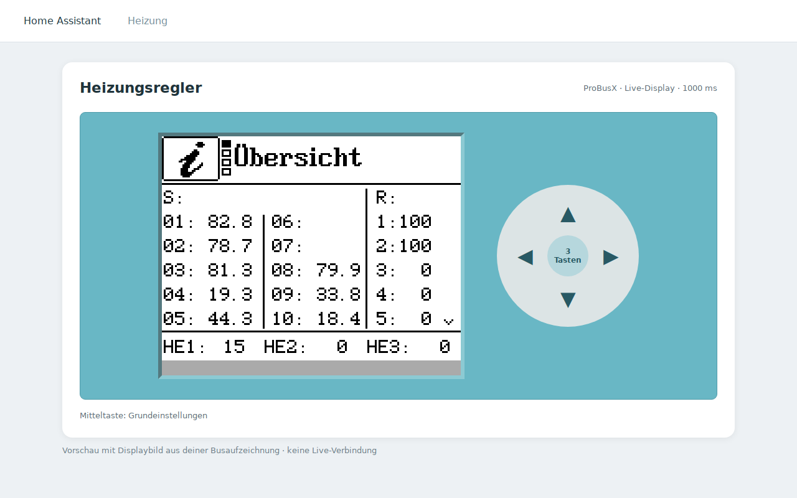
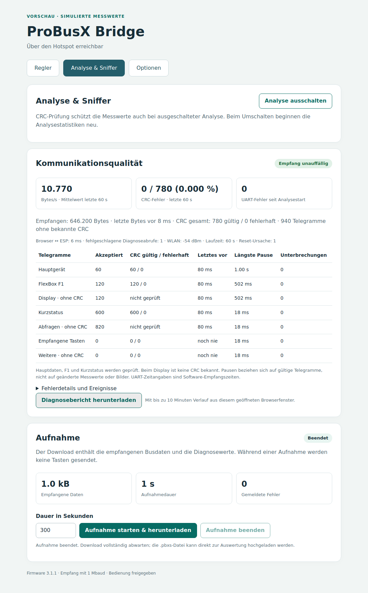
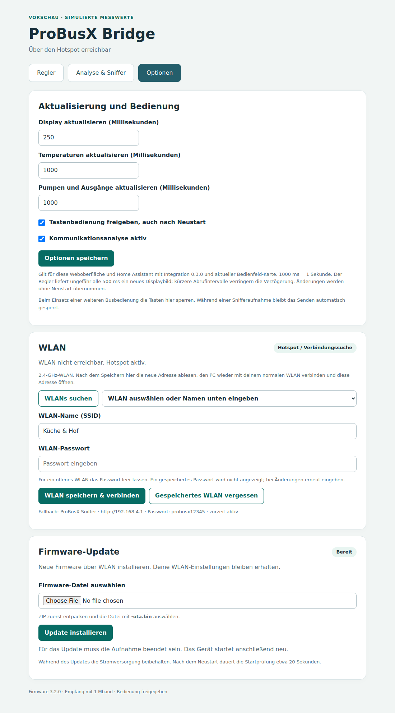

  

# ProBusX Bridge

Die ProBusX Bridge verbindet Prozeda-Heizungsregler über MQTT mit Home Assistant.
Eine eigene Weboberfläche ersetzt die weiteren Conexio-Funktionen: Displayspiegelung, Fernbedienung, Heizungsschema und Verlaufsgraphen.

## Home Assistant

| Funktion | Umfang |
| --- | --- |
| Einbindung | MQTT mit automatischer Entity-Erkennung über Discovery |
| Entities | Temperaturen, Ausgangsstellwerte, Ein/Aus-Zustände und Diagnosewerte |
| Display und Bedienung | Displaykamera, vier Richtungstasten und Dreitastendruck |

Die Komponente unter `home_assistant/custom_components/probusx` wird nur für den Betrieb ohne MQTT benötigt.
Sie verbindet Home Assistant direkt über HTTP mit der Bridge.
MQTT bietet automatische Erkennung ohne eigene HA-Komponente, benötigt aber einen Broker.
HTTP benötigt keinen Broker, fragt dafür regelmäßig die Bridge ab und erfordert die manuelle Komponentenpflege.
Den Funktionsvergleich und die Einrichtung beschreibt [Home Assistant](docs/Home-Assistant.md).

Die Abbildungen zeigen ältere Vorschauen mit simulierten Messwerten und einem aufgezeichneten Displaybild.
Aufbau und Beschriftungen der aktuellen Weboberfläche weichen davon ab.

## Weboberfläche

| Funktion | Umfang |
| --- | --- |
| Displayspiegelung | Live-Anzeige des Reglerdisplays mit 160 × 128 Pixeln und vier Graustufen |
| Reglerbedienung | Vier Richtungstasten und Dreitastendruck für die Grundeinstellungen |
| Live-Werte | Getrennte Tabellen für Temperaturen und Ausgangsstellwerte von Hauptregler und FlexBox 1 |
| Heizungsschema | Eigenes Bild hochladen und speichern; Messwerte und Ausgänge im Bild anzeigen |
| Schema bearbeiten | Anzeigen verschieben, ein- und ausblenden sowie eigene Bezeichnungen vergeben; Änderungen nur im Editiermodus |
| Verlaufsgraphen | Zwei Diagramme für Temperaturen und Ausgänge einschließlich FlexBox; Kanäle einzeln ein- und ausschalten |
| Zeitwahl und Zoom | Von/bis, Zeitvorgaben und Mauszoom; derselbe Zeitbereich in beiden Graphen |
| Datenaufzeichnung | RAM-Verlauf mit einstellbarem Speicherintervall; Rohaufnahmen im PBXS-Format |
| Diagnose | CRC-Prüfung der bekannten Telegrammfamilien und Fehlerzähler |
| WLAN | Zugangspunktliste, automatische Wahl, feste BSSID-Bindung und Ersatzhotspot |
| Wartung | OTA-Update und Neustart |

Der RAM-Verlauf beginnt nach jedem Neustart neu.
Alle Webfunktionen arbeiten auch ohne MQTT-Broker und Home Assistant.

Analyse und Optionen ansehen

Kommunikationsdiagnose und Rohaufnahme:

Anzeigeintervalle, WLAN und Firmware-Update:

## Unterstützte Regler

| Gerät | Stand |
| --- | --- |
| Prozeda REGULA | Hauptregler: Temperaturen, Ausgänge, Display und Tasten geprüft |
| FlexBox 1 | Vier Temperatureingänge; F1R1 und F1R3 mit aktiven Ausgangswerten geprüft |
| FlexBox 2 und 3 | Noch nicht unterstützt |
| Weitere Regler und OEM-Ausführungen | Anpassung und Prüfung erforderlich |

Prozeda ist ein OEM-Hersteller. Die Regler werden auch unter den Markennamen anderer Heizungshersteller vertrieben.
Weitere neuere Prozeda-Regler mit ProBusX können über angepasste Telegrammzuordnungen ergänzt werden.

## Hardware

Aktuell unterstützt: [Waveshare ESP32-S3-RS485-CAN / -U](https://www.waveshare.com/esp32-s3-rs485-can.htm).

Weitere ESP32-Platinen benötigen WLAN und/oder LAN, einen Hardware-UART für 1.000.000 Baud und GPIOs für RX, TX und Senderfreigabe.
Der vorhandene Build setzt einen ESP32-S3 mit 16 MiB Flash und 8 MiB Octal-PSRAM voraus.
Andere Varianten benötigen eine angepasste Buildkonfiguration und Pinbelegung.

Der RS485-Transceiver muss Halbduplex mit mindestens 1 Mbit/s, ESP32-kompatible 3,3-V-Logik und eine steuerbare Senderfreigabe unterstützen.
Isolation und Pegelwandler müssen ebenfalls mindestens 1 Mbit/s übertragen.
Bausteinbeispiele bei 3,3-V-Versorgung: [MAX3485](https://www.analog.com/en/products/max3485.html) bis 10 Mbit/s oder [THVD1450](https://www.ti.com/product/THVD1450) bis 50 Mbit/s.

## Dokumentation

| Thema | Anleitung |
| --- | --- |
| Installation und WLAN | [Installation](docs/Installation.md) · [WLAN](docs/WLAN.md) |
| Home Assistant | [MQTT](docs/MQTT.md) · [MQTT/HTTP-Vergleich und Dashboard](docs/Home-Assistant.md) |
| Bedienung | [Weboberfläche](docs/Bedienung.md) · [Schema](docs/Heizungsschema.md) · [Verlauf](docs/Verlauf.md) |
| Entwicklung | [Projektaufbau](docs/Architektur.md) · [Build](docs/Entwicklung.md) · [AGENTS.md](AGENTS.md) |
| Busanalyse | [Protokoll](docs/Protokoll.md) · [Prüfungen](docs/Pruefungen.md) · [Offene Punkte](docs/Offene-Punkte.md) |
