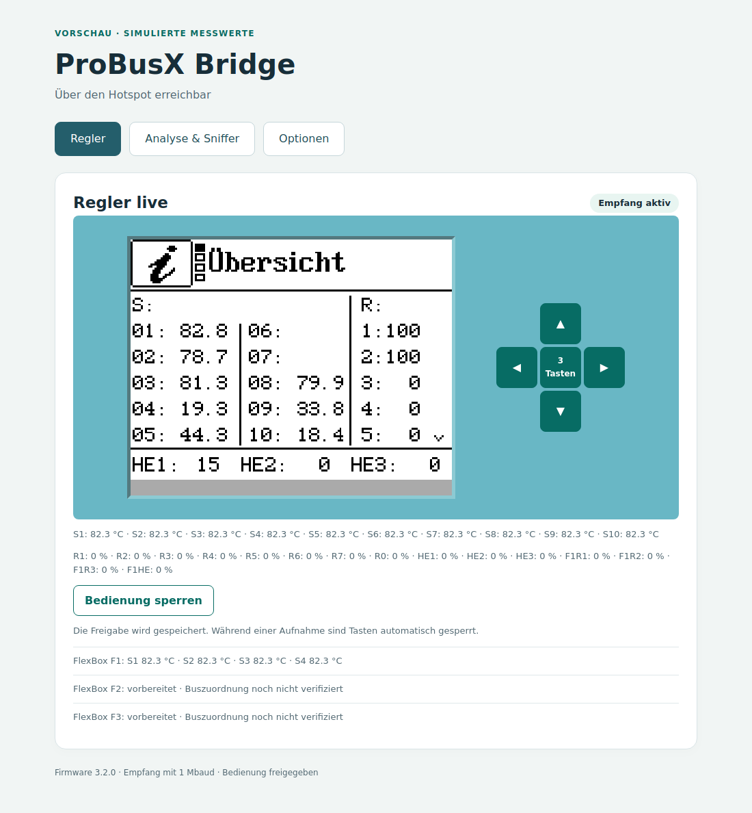

# ProBusX Bridge

Die ProBusX Bridge verbindet einen Prozeda-Heizungsregler mit Home Assistant.
Ein Waveshare ESP32-S3 liest die Daten direkt am RS485-Bus.
Die Bridge ersetzt in diesem Aufbau die Conexio.

Das Projekt enthält den vollständigen eigenen Quellcode.
Es enthält die Firmware, die HA-Integration, die Dashboard-Karte und die Tests.
Die Conexio-Dateien `medius_val.xml` und `display.bmp` werden nicht benötigt.

## Funktionen

- Temperaturen des Hauptreglers und der ersten FlexBox lesen.
- Ausgangsstellwerte in Prozent und als Ein/Aus-Zustand anzeigen.
- Das Reglerdisplay mit 160 × 128 Pixeln darstellen.
- Vier Richtungstasten und den Dreitastendruck senden.
- Kommunikationsfehler und bekannte CRC-Prüfsummen prüfen.
- Rohdaten über den Browser oder TCP aufzeichnen.
- WLAN über einen Zugangspunkt einrichten.
- Bei WLAN-Ausfall einen Ersatzzugangspunkt bereitstellen.
- Firmware über WLAN aktualisieren.
- Anzeigeintervalle und Sendefreigabe dauerhaft speichern.

Die Firmware verwendet ESP-IDF. Sie ist keine ESPHome-Konfiguration.
Die HA-Komponente ist eine benutzerdefinierte Integration. Sie ist kein Supervisor-Add-on.
Die Verbindung zwischen Home Assistant und Bridge nutzt lokales HTTP.

## Versionsstand

| Bestandteil | Version |
| --- | --- |
| Projekt und HA-Integration | 0.3.1 |
| ESP32-Firmware | 3.2.1 |
| HTTP-Datenschema | 1 |
| Aufnahmeformat | PBXS, Version 2 |

Die Ausgangsbasis war Integration 0.3.0 mit Firmware 3.2.0.
Diese Fassung ordnet die Quellen für GitHub und ergänzt deutsche Kommentare.
Die bekannten API-Felder und Entity-IDs bleiben erhalten.
Neue Firmwaredateien heißen `probusx-bridge-waveshare-*.bin`.
Der Zugangspunkt heißt ab dieser Fassung `ProBusX-Bridge`.

## Einstieg

1. [Installation ausführen](docs/Installation.md).
2. [Home Assistant einrichten](docs/Home-Assistant.md).
3. [Bedienung und Updates lesen](docs/Bedienung.md).

Für die Entwicklung:

- [Projektaufbau und Datenfluss](docs/Architektur.md)
- [Firmware selbst bauen](docs/Entwicklung.md)
- [ProBusX-Protokoll](docs/Protokoll.md)
- [HTTP-Schnittstelle und Aufnahmeformat](docs/Schnittstellen.md)
- [Prüfungen und Nachweise](docs/Pruefungen.md)
- [Fehler suchen](docs/Diagnose.md)
- [Offene Protokollfelder](docs/Offene-Punkte.md)
- [Schreibregeln für technische Texte](docs/Schreibregeln.md)
- [Projekt auf GitHub laden](docs/GitHub.md)

## Hardware und Bus

Die Firmware ist für den Waveshare ESP32-S3-RS485-CAN / -U vorgesehen.
Die verwendete Ausführung benötigt 16 MiB Flash und 8 MiB Octal-PSRAM.
Das frühere Waveshare RS485-Ethernet-Gerät verwendet diese Firmware nicht.

| Signal | Einstellung |
| --- | --- |
| Busanschluss | RS485, A+ und B− |
| Baudrate | 1.000.000 Baud |
| Zeichenformat | 8 Datenbits, keine Parität, 1 Stoppbit |
| UART-Empfang | GPIO18 |
| UART-Senden | GPIO17 |
| Bustreiber-Freigabe | GPIO21; High aktiviert den Sender |

Die Baudrate stammt aus den erfolgreich dekodierten Aufnahmen dieser Anlage.
Sie ist keine Zusicherung für alle Prozeda-Regler oder alle Waveshare-Varianten.
Die erfassten Telegramme enthalten etwa zwei vollständige Displaybilder je Sekunde.

## FlexBoxen

Die FlexBoxen sind laut Betreiber baugleich.
Ein DIP-Schalter legt ihre Modulnummer fest.
Die Plätze F1, F2 und F3 sind in der API vorgesehen.

Nur F1 ist anhand eines Mitschnitts zugeordnet.
Die Buskennung von F1 lautet `40` im Kopf `A5 13 40 01 F0`.
Die Modulnummer 1 ist daher nicht einfach das Kopfbyte `01` oder `40`.
Die Zuordnung für F2 und F3 muss noch am Bus bestätigt werden.
Bis dahin bleiben diese Plätze als nicht unterstützt gekennzeichnet.

## Bekannter Umfang

Home Assistant erzeugt 61 Entities:

- 14 Temperatursensoren.
- 15 Ausgangswerte und 15 binäre Ausgangszustände.
- 11 Diagnosesensoren.
- Eine Displaykamera.
- Fünf Tasten.

Die F1-Ausgänge sind vorläufig zugeordnet.
In den bisherigen Aufnahmen waren diese Ausgänge immer aus.
Die Displaytelegramme haben noch keine nachgewiesene CRC-Prüfung.
Die übrigen bestätigten CRC-Regeln stehen in der Protokolldokumentation.

## Abbildungen

Die Bilder zeigen die bisherige Oberfläche mit Testdaten.
Einzelne Bezeichnungen können vom neuen Quellstand abweichen.

## Projektstatus

Der Betreiber verwendet die bisherige Bridge ohne Conexio.
Automatische Tests prüfen Dekodierung, Bildaufbau, Tastenfolge, HTTP und Updates.
Ein bestandener Test bestätigt keinen elektrischen Busaufbau.
Die Prüfergebnisse dieser Fassung stehen in [Prüfungen](docs/Pruefungen.md).

Ein angeforderter Tastendruck kann Einstellungen des Heizungsreglers ändern.
Bei einer weiteren aktiven Busbedienung die Tasten der Bridge sperren.
Während einer Rohaufnahme sendet die Bridge keine Tastenantworten.

## Lizenz

Für den eigenen Projektcode ist noch keine Nutzungslizenz festgelegt.
Die Einzelheiten stehen in [LIZENZ.md](LIZENZ.md).
Abhängigkeiten behalten ihre eigenen Lizenzen.

## Quellen

- [Waveshare-Platine und Anschlussbelegung](https://www.waveshare.com/wiki/ESP32-S3-RS485-CAN)
- [ESP-IDF-Dokumentation](https://docs.espressif.com/projects/esp-idf/en/v5.5/esp32s3/)
- [Home-Assistant-Entwicklerdokumentation](https://developers.home-assistant.io/)

Dieses Projekt ist eine eigenständige Entwicklung.
Es ist kein offizielles Produkt von Prozeda, Waveshare oder Home Assistant.
